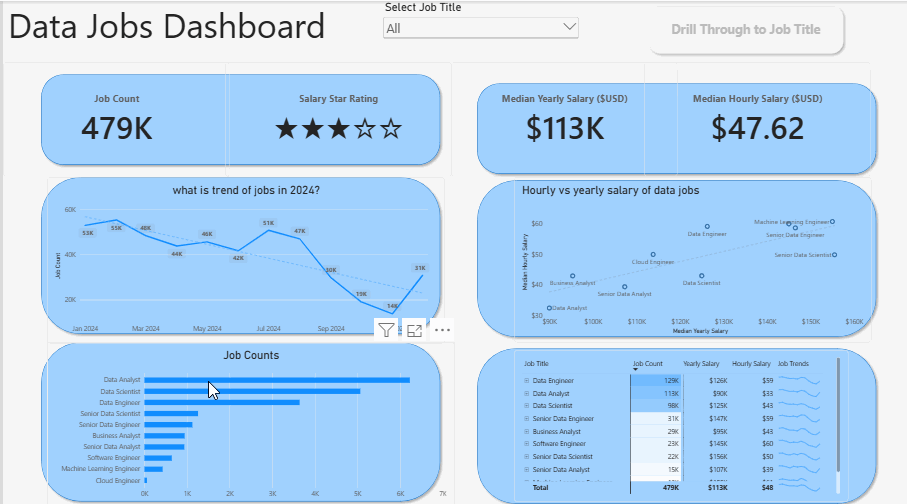
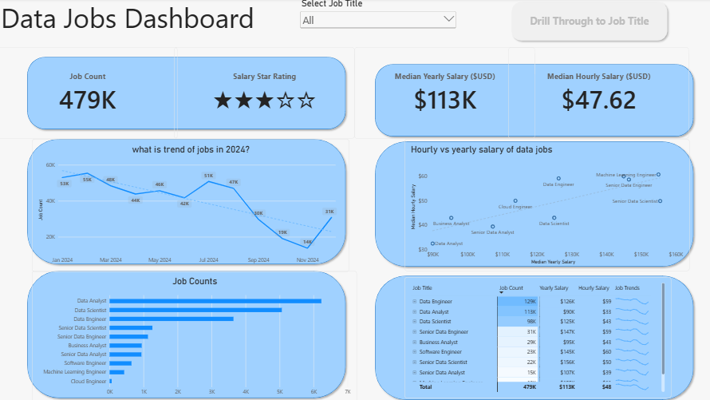
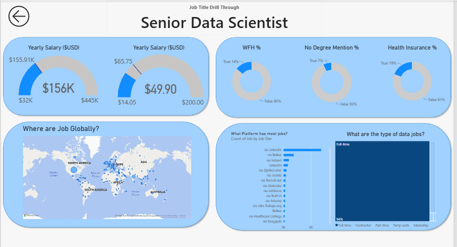

# 📊 Data Jobs Dashboard (Power BI)

An interactive Power BI dashboard analyzing **479K+ data job postings** across 2024. It explores job volume trends, compensation benchmarks, hiring platforms, remote work availability, and global demand by role.

---

## 🔍 Overview & Key Insights

* **Total Jobs Analyzed:** 479K postings across 10 core data roles[cite: 1].
* **Overall Median Pay:** **$113K/year** and **$47.62/hour**[cite: 1].
* **Top Roles by Volume:** Data Engineer (129K), Data Analyst (113K), and Data Scientist (98K) make up the majority of postings[cite: 1].
* **Highest Paying Roles:** Senior Data Scientist ($156K median) and Senior Data Engineer ($147K median) lead in annual compensation[cite: 1].
* **2024 Trend:** Job postings started strong in Q1 (peaking at 55K in February) before gradually declining toward the end of the year[cite: 1].

---

## 🖥️ Dashboard Pages

### 1. Main Overview (`Data Jobs Dashboard`)
* **KPI Cards:** Total job count (479K), salary star rating, median yearly salary ($113K), and median hourly salary ($47.62)[cite: 1].
* **2024 Job Trend:** Monthly line chart with a trendline tracking job volume from Jan to Dec 2024[cite: 1].
* **Hourly vs. Yearly Salary:** Scatter plot comparing median hourly and annual pay across job titles[cite: 1].
* **Role Breakdown:** Bar chart and detailed matrix showing job counts, median salaries, and sparkline trends per title[cite: 1].
* **Interactive Controls:** Filter by `Select Job Title` or use the **Drill Through to Job Title** button to inspect a specific role[cite: 1].

### 2. Role Deep-Dive (`Job Title Drill Through`)
* **Salary Gauges:** Min, median, and max ranges for yearly and hourly pay (e.g., Senior Data Scientist ranges from $32K to $445K/year)[cite: 2].
* **Benefits & Requirements:** Donut charts showing percentages for **Work From Home (WFH)**, **No Degree Mentioned**, and **Health Insurance**[cite: 2].
* **Global Demand:** Bubble map highlighting job distribution across North America, Europe, Asia, and beyond[cite: 2].
* **Platforms & Job Types:** Breakdown of top hiring sources (LinkedIn, BeBee, Indeed) and employment types (Full-time, Contractor, Part-time, etc.)[cite: 2].

---

## 🛠️ Tools & Techniques Used

* **Power BI Desktop:** Data modeling, interactive visuals, custom KPI cards, gauges, and sparklines.
* **DAX:** Custom measures for median salaries, percentage breakdowns, dynamic star ratings, and trend calculations.
* **Power Query:** Data cleaning, transformation, and standardization of job titles, salaries, and job platforms.
* **UX Features:** Cross-filtering slicers, custom drill-through page, and navigation buttons.

---

## 🚀 How to Use

1. Download the `.pbix` file from this repository.
2. Open it in **Power BI Desktop**.
3. Use the **Select Job Title** dropdown on the main page to filter metrics, or right-click any job title (or use the top-right button) to **Drill Through** to the detailed role view.

---

## 📸 Screenshots

### Main Dashboard

### Job Title Drill Through

## 🙏 Acknowledgments

* **Dataset & Project Inspiration:** Built while following [Luke Barousse's](https://www.youtube.com/@LukeBarousse) Power BI Data Analytics course, using the 2024 Data Jobs dataset provided in the curriculum.